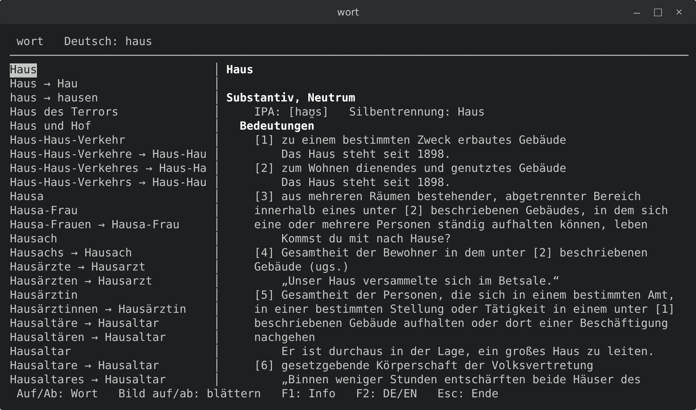

# wort

An offline German–German dictionary for the terminal, built from the German
Wiktionary and OpenThesaurus. One small C program runs on Windows 98 and
Mac OS X Panther all the way up to Windows 11, current macOS, FreeBSD,
OpenBSD and Linux. It needs no internet connection, no installer and no
runtime.



## Features

- About 186,000 headwords: meanings with one example each, IPA, hyphenation,
  synonyms (Wiktionary and OpenThesaurus merged), antonyms and English
  translations
- Inflected forms lead to the base form: *ging* finds *gehen*, *Häuser* finds
  *Haus*
- No umlaut keys? Type `ae`, `oe`, `ue` and `ss`: `haeuser` finds *Häuser*.
  Accents can be left out too
- English to German: F2 in the TUI, or `wort -e house`
- Full-screen TUI, and a plain mode for scripts (`wort Haus`)
- Light on old hardware: lookups are binary searches in plain text files, so
  wort needs little memory and stays quick on the Windows 98 and Panther
  machines it was tested on

## Runs everywhere

wort is written in plain C89 against curses: ncurses on Unix and macOS, and
PDCurses compiled into the program on Windows. The same source builds with
gcc 3.3 on a 2003 PowerPC Mac and with today's clang. One `.exe` runs on
every Windows from 98 to 11. On Unix, `make` detects the OS by itself, with
GNU make or BSD make.

Text is shown in whatever the system can display: UTF-8 on modern systems,
Latin-1 on Panther and Tiger, the DOS code page in the Windows console.
Umlauts and ß work everywhere. Characters a system lacks are replaced with
plain ones (`„“` become `"`, IPA letters become `?`).

### Tested systems

Each of these passed the full checklist in [`checklists.txt`](checklists.txt)
on real hardware, not in emulators:

| System | Notes |
|---|---|
| Windows 98 | Run from a USB stick and from the hard disk |
| Windows XP | |
| Windows 11 | |
| Mac OS X 10.3.9 Panther (PowerPC) | Latin-1 build; F1/F2 don't work in its Terminal, see [Notes](#notes) |
| Mac OS X 10.5.8 Leopard | F1/F2 don't work in its Terminal |
| macOS 10.15 Catalina | |
| FreeBSD 15.1 | |
| OpenBSD 8 | |
| Linux (Arch) | |

On every pull request, CI also builds wort on Linux, macOS, FreeBSD, OpenBSD
and Windows.

Untested but expected to work: Windows 2000, Vista, 7, 8 and 10; Mac OS X 10.4
Tiger (same setup as Panther), 10.6 and later; macOS 11 and later on Intel and
Apple Silicon; other Linux distributions.

## Installation

### From a release

Download the archive for your system from the
[Releases](https://github.com/kasramp/wort/releases) page.

**Windows 98 to 11:** unzip `wort-<version>-windows.zip` and run `wort` in a
Command Prompt from that folder. Nothing to install.

**Linux, FreeBSD, OpenBSD, macOS:** the archive holds the source and the
ready-built data. You need a C compiler and curses; on macOS, the Xcode
command line tools; on Debian and Ubuntu, `libncurses-dev`.

```
$ tar xzf wort-<version>-unix.tar.gz
$ cd wort-<version>-unix
$ make
$ sudo make install
```

This installs `wort` to `/usr/local/bin`, its data to
`/usr/local/share/wort` and the man page. `make uninstall` removes them again.
For another location, pass the same `PREFIX` to both commands
(`make PREFIX=$HOME/.local` and `make install PREFIX=$HOME/.local`), because
the data path is compiled into the program.

### From source

Building the data needs Python 3 (standard library only) and about 2 minutes:

```
$ git clone https://github.com/kasramp/wort
$ cd wort
$ tools/snapshot.sh      # downloads today's Wiktionary extract and OpenThesaurus (~320 MB)
$ make data              # builds build/data/ (~130 MB)
$ make
$ sudo make install
```

`tools/snapshot.sh` adds each download to `data/SOURCES`. If kaikki.org or
OpenThesaurus is down, it falls back to the snapshots kept in the
[`data-snapshots`](https://github.com/kasramp/wort/releases/tag/data-snapshots)
release (this needs the GitHub CLI, `gh`).

wort also runs without being installed: it finds its data next to the
program, or in the directory named by `WORT_DATA`.

## Usage

```
wort              full-screen dictionary
wort Haus         print the entry for Haus and exit
wort -e house     look up an English word, print the German entries
```

In the full-screen dictionary:

| Key | Action |
|---|---|
| typing | Search as you type |
| Up / Down | Pick a word from the list |
| Page Up / Page Down | Scroll the entry |
| F1 | Info page: data sources, licences, snapshot dates |
| F2 | Switch the search between German and English |
| Backspace | Delete the last character |
| Esc | Quit |

Plain mode exits with status 0 when it finds the word, 1 when it doesn't
(it then lists similar words), and 2 when the data files are missing. See
also `man wort`.

## Notes

### Mac OS X 10.3 and 10.4

The ncurses in Panther and Tiger counts UTF-8 bytes as screen columns, so
umlauts would leave stray characters behind. The Makefile therefore builds a
Latin-1 version on these systems. Set the Terminal to match: **Window Settings
→ Display → Character Set Encoding → Western (ISO Latin 1)**.

### macOS Terminal

- Page Up/Down scroll the Terminal window itself. Use **Shift+Page Up/Down**
  (on laptops **fn+Shift+↑/↓**) to scroll the entry in wort.
- In the Terminal of OS X 10.3 to 10.5, F1 and F2 don't work (on Panther they
  quit wort), because that Terminal sends key codes the system doesn't
  recognise.

### Windows

- Run wort in a Command Prompt window. On Windows 98 it does not run in real
  "MS-DOS mode", because it is a Win32 program.
- The console uses the DOS code page, so quotes, dashes and IPA letters are
  replaced with plain characters.

### Text consoles

On the plain text consoles of Linux and the BSDs (outside X), some characters
may show as boxes, depending on the console font. Terminal emulators show
everything.

## Development

### Building for Windows

The `.exe` is cross-built on Linux with OpenWatcom v2 (Arch: AUR package
`openwatcom-v2`). PDCurses 3.9 is compiled in, so no DLLs are needed.

```
$ . /opt/watcom/owsetenv.sh
$ make win32             # writes build/win32/wort.exe
```

Copy `wort.exe` and the three files from `build/data/` into one folder.

- PDCurses is the narrow (non-Unicode) build, because the Unicode build does
  not run on Windows 9x.
- Large local arrays crash wort at start on real Windows (they skip the stack
  guard page), even though Wine runs them fine. Keep locals under 4 KB and
  make big buffers `static`.
- Don't use PDCurses' `Makefile.wcc` on Linux (OpenWatcom writes `.o`, not
  `.obj`), and don't define `HAVE_NO_INFOEX` (it clashes with OpenWatcom's
  headers).

### Data

`tools/build-db.py` turns the raw downloads into three text files:
`wort.dat` (the entries), `wort.idx` (the search index) and `wort-en.idx`
(English to German). The first line of `wort.dat` records the snapshot
dates shown on the F1 page. Every snapshot used so far is listed with its
checksum in `data/SOURCES` and kept in the `data-snapshots` release, so any
release can be rebuilt even if the upstream files disappear.

`cursetest/` is a small program that checks text output and keys on a new
system (`make`, with `LIBS=-lcurses` on OpenBSD and `LIBS=-lncurses` on
macOS).

`docs/make_screenshot.py` regenerates the screenshot above.

### CI and releases

`.github/workflows/build.yml` builds wort on Linux (strict C89, warnings
are errors), macOS, FreeBSD, OpenBSD and Windows for every pull request and
every push to `main`.

Releases are started by hand: **Actions → release → Run workflow** on `main`,
with a version such as `v0.1.0`. The workflow:
1. fetches fresh data, falling back per source to the newest kept snapshot,
2. builds the data and `wort.exe`,
3. stores new raw files in `data-snapshots` and commits their checksums,
4. publishes the Windows zip and the Unix tarball.

## License

The code is GPL-3.0-or-later (see [LICENSE](LICENSE)). The dictionary data
keeps its own licences:

- German Wiktionary: CC BY-SA 4.0, extracted with
  [wiktextract](https://kaikki.org)
- [OpenThesaurus](https://www.openthesaurus.de): LGPL 2.1 or CC BY-SA 4.0
